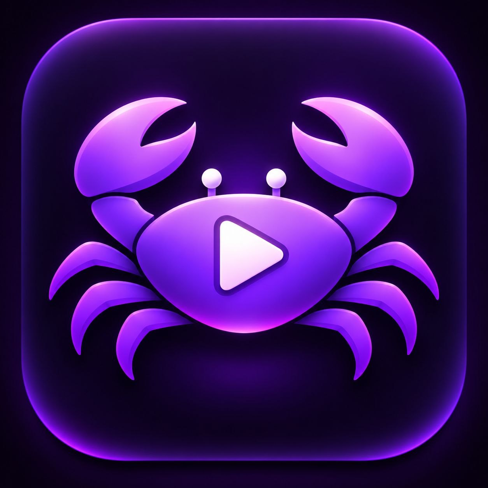
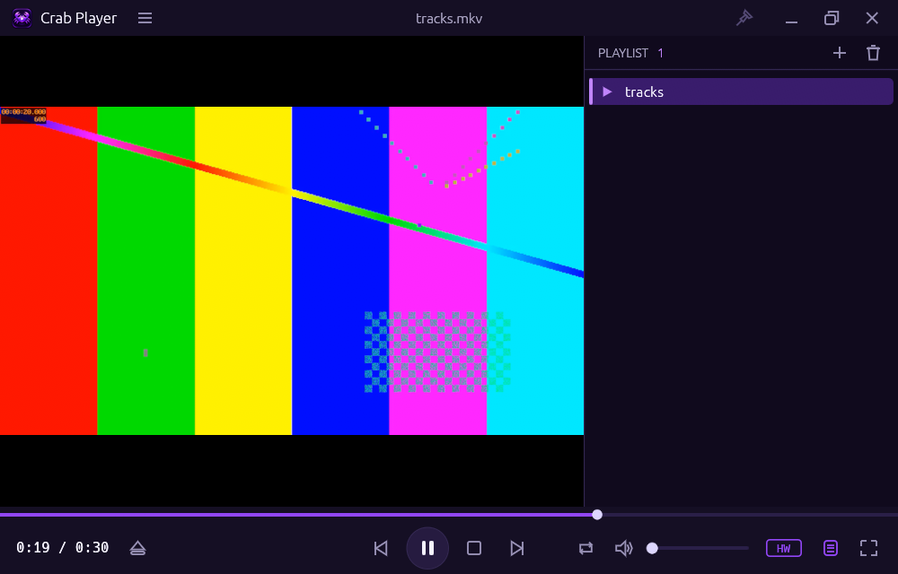
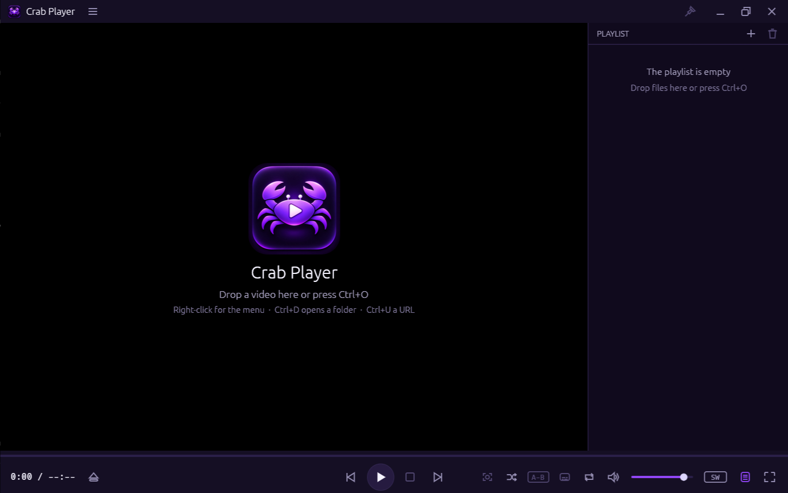
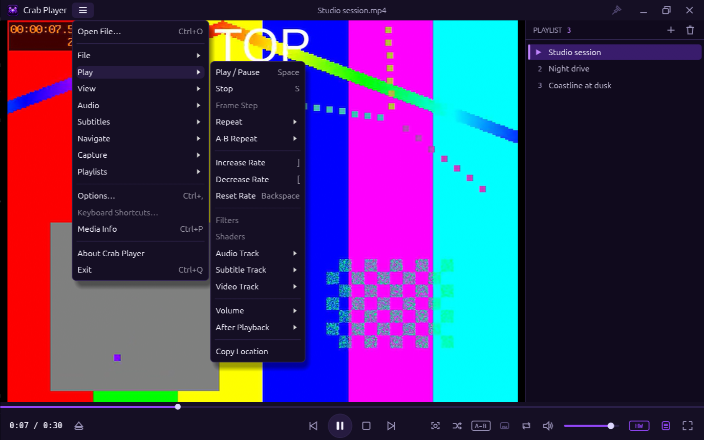
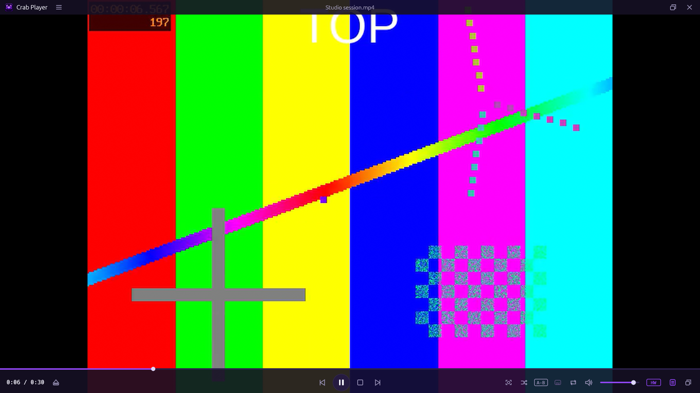
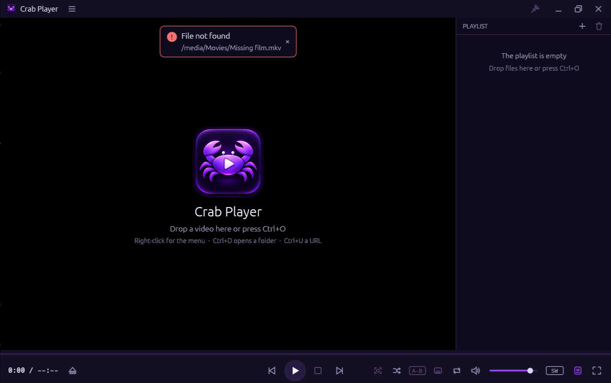
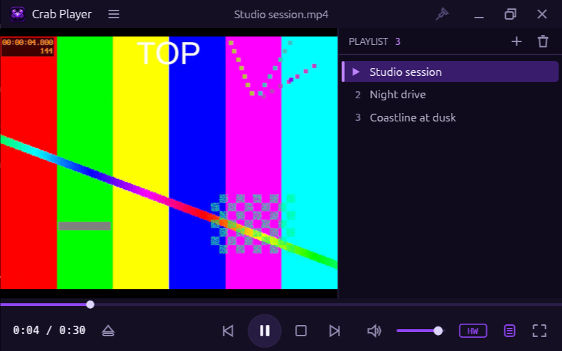

<h1 align="center">
  
  Crab Player
</h1>

A fast, native media player for Linux with a classic desktop-player layout:
a slim caption strip with the logo and menu, the video, a full-width seek
bar over a centred transport bar, and a docked playlist. Written in Rust, with
[egui](https://github.com/emilk/egui) for the interface and
[libmpv](https://mpv.io) for demuxing, decoding and rendering.

Crab Player is an independent project. It contains no code or assets from
other players.

## Screenshots

Taken from the running app on Hyprland at 1.25× scale.

| Playing | Welcome |
| --- | --- |
|  |  |
| **Main menu** | **Full screen (controls shown)** |
|  |  |
| **Error banner** | **Minimum window size** |
|  |  |

## Features

- Plays everything the installed FFmpeg decodes: local files, folders
  (added recursively) and network streams (any URL mpv accepts:
  `http(s)`, `rtsp`, `rtmp`, `udp`, `srt`, …). See
  [`docs/codec-support.md`](docs/codec-support.md) for what was tested.
- Opens files every way you expect: command line, file manager / "Open
  with" (`file://` URIs with spaces and non-Latin names), File ▸ Open (a
  native portal dialog that never freezes the window), drag and drop
  (including on native Wayland), Open URL, the playlist's Add button.
- Clear, non-blocking error messages when a file cannot be opened or
  decoded (not found, permission denied, unsupported format, decoder
  error); hardware-decoding failures retry in software automatically.
- Video rendered inside the window through mpv's render API, sharp at
  fractional scale factors, letterboxed, with rotation and aspect-ratio
  override.
- Hardware decoding: VA-API zero-copy on Wayland, with an HW/SW badge that
  shows the active decoder and switches it.
- Media Info dialog: container, codecs, profile, pixel format, resolution,
  frame rate, bitrates, audio channels and sample rate, and the decoder in
  use.
- Audio, subtitle and video track selection; external subtitle files;
  audio and subtitle delay.
- A-B repeat, repeat file / playlist, shuffle, playback speed, go to time.
- Picture controls (brightness, contrast, saturation, hue), save image.
- Playlist with natural sorting, by name or folder, and random order.
- Caption strip with the logo, a main menu and the window buttons; a
  right-click menu on the video; every action also has a command behind
  it, so menus, buttons and keys behave the same.
- Full screen with fading, auto-hiding controls drawn over the picture;
  layout presets; always on top (X11).
- Layout and settings persist in a TOML file.

Planned, and shown disabled in the menus: equalizer, shaders, thumbnails
and GIF capture, DVD/BD navigation, a shortcut editor.

## Install and run

### Dependencies

Runtime: `libmpv` 0.35 or newer (`libmpv.so.2`), FFmpeg, an OpenGL 3.0 /
GLES 3.0 driver, Wayland or X11. Optional: `xdg-desktop-portal` (plus a
backend such as `xdg-desktop-portal-gtk`) for the file dialogs, and a
VA-API driver for hardware decoding.

| Distribution | Build and runtime packages |
| --- | --- |
| Arch | `sudo pacman -S --needed base-devel rust mpv ffmpeg` (optional: `xdg-desktop-portal-gtk`, `libva-mesa-driver` or `intel-media-driver`) |
| Debian / Ubuntu (untested) | `sudo apt install build-essential cargo pkg-config libmpv-dev libmpv2 ffmpeg libavcodec-extra` (optional: `xdg-desktop-portal-gtk`, `mesa-va-drivers` or `intel-media-va-driver`) |

Rust 1.95 or newer is required.

### Install for your user (no root)

```sh
scripts/install.sh      # builds the release binary and installs it into ~/.local
crab-player             # or start "Crab Player" from the application launcher
scripts/uninstall.sh    # removes exactly what install.sh put there
```

This installs `~/.local/bin/crab-player`, the desktop entry
`~/.local/share/applications/io.github.mahziyarng98.CrabPlayer.desktop` and the icons under
`~/.local/share/icons/hicolor/`. Crab Player shows up in the launcher and
under "Open with" for video and audio files; your default applications are
not changed.

### Arch package (system-wide)

```sh
packaging/arch/build-local.sh                               # builds target/arch/*.pkg.tar.zst
sudo pacman -U target/arch/crab-player-0.1.0-1-x86_64.pkg.tar.zst
```

See [`packaging/README.md`](packaging/README.md) for Debian and Flatpak
(both untested).

### Build and run from the checkout

```sh
cargo build --release
./target/release/crab-player /path/to/movie.mkv
```

A UI-only build without libmpv, for working on the interface:

```sh
cargo build --release --no-default-features
```

### Run

```sh
crab-player                           # welcome screen; drop files on it
crab-player movie.mkv                 # a file or a URL
crab-player ~/Videos                  # a folder, added recursively
crab-player movie.mkv movie.srt       # media plus an external subtitle file
crab-player a.mkv b.mkv               # queue several items
crab-player --version
```

Settings live in `$XDG_CONFIG_HOME/crab-player/config.toml` (usually
`~/.config/crab-player/config.toml`) and are written on exit. A broken
settings file does not stop the player: it starts with defaults, keeps the
file as `config.invalid.toml` and says so. Saved images go to
`~/Pictures/crab-player/`.

## Supported formats

"All codecs" means **everything the FFmpeg installed on your system can
decode**: Crab Player adds no whitelist of its own, and mpv/FFmpeg pick the
demuxer and decoder. On Arch the `ffmpeg` package is a full build. On
Debian/Ubuntu install `libavcodec-extra` for the codecs that are packaged
separately.

Tested here (62 generated clips, all passing): H.264 8/10-bit and 4:2:2 /
4:4:4, HEVC 8/10-bit and 4:4:4, VP8, VP9 (incl. 10-bit), AV1 (incl. 10-bit),
MPEG-1, MPEG-2 (incl. interlaced), MPEG-4 Part 2 / Xvid / DivX 3, H.263,
Theora, ProRes, Motion JPEG, WMV 7/8, Sorenson Spark, FFV1, HuffYUV, DV,
RealVideo; AAC, MP3, MP2, Opus, Vorbis, FLAC, ALAC, AC-3, E-AC-3, DTS,
TrueHD, PCM, WMA, WavPack, TTA, AMR; in Matroska, MP4, WebM, AVI, MOV, MPEG-TS,
MPEG-PS, FLV, Ogg, ASF/WMV, MXF, 3GP, RealMedia and raw DV; SubRip, ASS,
mov_text and WebVTT subtitles, embedded and external. Details, including
which ones decode in hardware, are in
[`docs/codec-support.md`](docs/codec-support.md).

Hardware decoding needs the right VA-API driver: `libva-mesa-driver` (AMD:
H.264, HEVC, VP9, and AV1 on RDNA2 and newer), `intel-media-driver` (Intel
Broadwell and newer), or the NVIDIA driver for NVDEC. Anything the GPU
cannot decode is decoded in software automatically.

## Keyboard shortcuts

| Key | Action |
| --- | --- |
| `Space`, `K` | Play / pause |
| `S` | Stop |
| `←` / `→` | Seek 5 s |
| `Shift+←` / `Shift+→` | Seek 60 s |
| `↑` / `↓` | Volume ±5 % |
| `M` | Mute |
| `[` / `]` | Speed down / up |
| `Backspace` | Reset speed |
| `PgUp` / `PgDn` | Previous / next item |
| `F`, `Enter`, middle click | Toggle full screen (double click on the video too) |
| `Esc` | Leave full screen |
| `F9` | Toggle playlist |
| `A` / `J` | Next audio / subtitle track |
| `Z` / `X` | Subtitle delay −/+ 100 ms |
| `Shift+Z` / `Shift+X` | Audio delay −/+ 100 ms |
| `L` | A-B repeat: set A, set B, off |
| `R` / `Shift+R` | Rotate clockwise / counter-clockwise |
| `Shift+A` | Aspect ratio back to the file's |
| `1` / `2` / `3` | Layout preset Minimal / Compact / Normal |
| `Ctrl+M` | Toggle the caption strip and menu (also `Ctrl+0`) |
| `Ctrl+1` / `Ctrl+2` | Toggle seek bar / controls |
| `Ctrl+G` | Go to time |
| `Ctrl+O` / `Ctrl+D` | Open file / folder |
| `Ctrl+U` | Open URL |
| `Ctrl+Shift+S` | Save image |
| `Ctrl+W` | Close media |
| `Ctrl+,` | Options |
| `Ctrl+P` | Media Info |
| `Ctrl+Q` | Quit |

Bindings are defined in `src/command.rs`.

## Hardware decoding

The default mode is mpv's `auto-safe`; change it in Options or in the config
file (`[playback] hwdec`). The HW/SW badge in the control bar and the
Statistics overlay show what is actually in use.

| Session | What you get |
| --- | --- |
| Wayland | VA-API with zero-copy (`vaapi`). 1080p H.264 measured at 6 % of one core. |
| X11 / Xwayland | Hardware decoding with a copy back (`vulkan-copy` on the test machine), not zero-copy. eframe creates a GLX context on X11, and mpv's VA-API interop needs EGL. Startup is also slower there (about 1.7 s to the first frame on the test machine). |
| Software OpenGL (llvmpipe) | Software decoding, enforced, with simpler scaling. |
| NVIDIA | NVDEC is left to mpv's defaults and has not been tested. |

For diagnostics, extra mpv options can be passed through the environment:

```sh
CRAB_PLAYER_MPV_OPTIONS="log-file=/tmp/mpv.log,msg-level=all=v" crab-player movie.mkv
RUST_LOG=crab_player=debug crab-player movie.mkv
```

## Performance

Measured on a Ryzen 5 7535HS with a Radeon 680M: 0.19 s from launch to the
first video frame, 6 % of one core for 1080p H.264 and 7 % for 4K HEVC with
VA-API, no dropped frames at 1080p over 60 s, and a 12.2 MB binary. Details and
method are in [`docs/performance.md`](docs/performance.md).

## Known limitations

- Idle memory is about 170 MB, above the project's 70 MB target.
- Zero-copy hardware decoding works on Wayland only (see above).
- Always on top depends on the window manager and does nothing on native
  Wayland, which has no protocol for it.
- The 16 px icon is too small for the logo's detail: the crab reads as a
  purple shape and the play button is lost.
- Track selection, delays and picture settings are not remembered per file.
- No subtitle styling options, equalizer, shaders or thumbnail capture yet.
- The Arch package has been built but not installed system-wide; the
  user-level install has been installed and tested. Debian and Flatpak
  packaging have never been built.
- Always on top cannot work on native Wayland (no protocol); the pin is
  disabled there.
- Settings from the project's earlier working name are copied to the new
  location on first start; the old files are left in place.

## Project layout

```
src/
  main.rs            CLI parsing and eframe bootstrap
  app.rs             window layout, command dispatch, persistence
  media.rs           paths, file:// URIs and URLs; open errors
  dialogs.rs         native file dialogs off the UI thread
  wayland_dnd.rs     file drops on native Wayland
  command.rs         command vocabulary and default key map
  config.rs          TOML settings, migration from the old name
  playlist.rs        playlist model, sorting, folder scanning
  startup.rs         startup timing marks
  player/            Player trait, libmpv backend, null backend
  ui/                theme, logo, icons, caption, menus, video canvas,
                     seek bar, control bar, playlist, error banner
assets/              logo and application icons
docs/                architecture, UI specification, performance, codecs,
                     screenshots
packaging/           desktop entry, Arch, Debian, Flatpak
scripts/             user install/uninstall, end-to-end render check,
                     codec matrix
```

## License

MIT. See [LICENSE](LICENSE).
